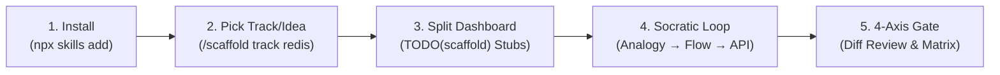

# 🏗️ Scaffold.ai — The Anti-Vibe-Coding Agent Skill

[](https://skills.sh)
[](https://opensource.org/licenses/MIT)
[](https://github.com/mo-farooq/Scaffold.ai)

> **Cure "AI Skill Atrophy".**  
> Scaffold is an open-source agent skill that transforms AI coding assistants from passive code generators into rigorous Socratic engineering mentors. It handles repetitive boilerplate wiring while protecting core logic with `TODO(scaffold)` stubs, enforces a live split-pane `PROGRESS.md` checklist, and gates milestones behind a **4-Axis Diff Review**.

---

## ⚡ Install in 5 Seconds

Scaffold installs cleanly into any repository through the universal `skills.sh` ecosystem:

```bash
npx skills add mo-farooq/scaffold
```

Works natively with **Google Antigravity**, **Claude Code**, **Cursor**, **Codex**, and **OpenCode**.

---

## 🥊 The Problem: The "Vibe-Coding" Trap

Current AI coding agents default to writing complete implementations for you. While convenient, this creates **severe AI skill atrophy**:
* Developers commit thousands of lines of code they couldn't explain in a technical interview or system design review.
* Complex distributed systems fail in production because the engineer never learned the underlying trade-offs.
* "Vibe coding" gives you the illusion of productivity while eroding your architectural intuition.

---

## 📊 How Scaffold Compares

| Dimension | Standard Coding Agents (Cursor / Copilot) | Built-in IDE Learning Modes (Claude Code / rules) | Text-Only Socratic Prompts | **Scaffold.ai Agent Skill** |
| :--- | :---: | :---: | :---: | :---: |
| **Always-On Anti-Dump Guardrail** | ❌ Dumps all code | ⚠️ Weak prompt, easily bypassed | ❌ None | **✅ Strict file-tool guardrail block** |
| **Boilerplate Glue vs. Core Stubs** | ❌ Writes everything | ❌ All or nothing | ❌ None | **✅ Writes glue, stubs `TODO(scaffold)`** |
| **Live Split-Pane Progress Tracker** | ❌ None | ❌ Ephemeral chat | ❌ None | **✅ Real-time `PROGRESS.md` & Matrix** |
| **Strictly Sequential Milestone Gate** | ❌ None | ❌ None | ❌ None | **✅ Deterministic sequential gating** |
| **4-Axis `git diff` Review Gate** | ❌ None | ❌ None | ❌ None | **✅ Correctness, Edges, Big-O, Security** |
| **5 Pre-Built Systems Tracks** | ❌ None | ❌ None | ❌ None | **✅ Redis, Git, HTTP, SQLite, Docker** |
| **Everyday Pre-Commit Mode** | ❌ None | ❌ None | ❌ None | **✅ `/scaffold quiz` on uncommitted diff** |

---

## 🔒 Guaranteed vs. Agent-Dependent Behavior

To keep distribution and integration transparent, Scaffold cleanly divides deterministic script guarantees from probabilistic agent behavior:

### What Scaffold Guarantees (Deterministic System)
* **Safe Project Initialization**: `init-scaffold.mjs` safely scaffolds `PROGRESS.md` and workspace rules without clobbering existing user progress unless `--force` is explicitly provided.
* **Strictly Sequential Gating**: `verify-gate.mjs` strictly permits verification of only the first unchecked milestone. Skipped milestones are rejected.
* **Idempotent State**: Re-running verification on already-completed milestones is safe, idempotent, and will never corrupt checklist state, badges, or matrix entries.
* **Deterministic Tracking**: Progress calculation, ASCII progress bars, Mental Model Matrix states (`🔴 / 🟡 / 🟢`), and the Aha Moments Journal are managed deterministically.

### What is Agent-Dependent (Probabilistic Model Behavior)
* **Adherence to Guardrails**: The rule `rules/scaffold-guardrails.md` instructs the agent not to write code inside `TODO(scaffold)` stubs. This is a behavioral system instruction, not an OS kernel sandbox.
* **Pedagogical Depth**: The nuance of Socratic progressive hints (Level 1 $\to$ 2 $\to$ 3) and the rigor of the 4-Axis diff evaluation depend on the reasoning capability of the host model (e.g. Claude 3.7 / 3.5 Sonnet, GPT-4o, Codex).

---

## 🔄 The 5-Phase Socratic Workflow



### Phase 1: Zero-Friction Install
Run `npx skills add mo-farooq/scaffold`. It mounts the canonical `skills/scaffold/` package into your editor's skill engine.

### Phase 2: Pick a Track or Custom Idea
* Custom Idea: `/scaffold Build a rate-limited API in Node.js`
* Curated Track: `/scaffold track redis` (or `git`, `http`, `sqlite`, `docker`)
* Optional `--hardcore`: Learner writes 100% of files; agent writes zero code.

### Phase 3: Split-Screen Dashboard & `TODO(scaffold)` Stubs
Scaffold writes `PROGRESS.md` in your workspace and initializes workspace guardrails:
* Open `PROGRESS.md` in your right editor split (`Markdown: Open Preview to the Side`).
* **Mentor Mode (Default)**: The agent scaffolds configuration files, environment setups, and test runners ("the glue"), but stubs core algorithmic functions with:
  ```typescript
  export function parseRespCommand(buffer: Buffer): RespCommand {
    // TODO(scaffold): Parse RESP stream chunks into commands without dropping bytes.
    // Must handle fragmented buffers and length-prefixed bulk strings ($<len>\r\n<payload>\r\n).
    throw new Error("TODO(scaffold): parseRespCommand not implemented");
  }
  ```
* **Guardrail**: The agent is strictly banned from writing logic inside `TODO(scaffold)`. **YOU write the core logic.**

### Phase 4: 3-Tier Socratic Guidance Loop
When stuck on a `TODO(scaffold)` block, ask your agent. Instead of spoiling the code, it escalates through 3 tiers:
1. **Level 1 (Conceptual Analogy)**: Real-world mental model & guiding question. *(Solves qualify for `🟢 Mastered`)*.
2. **Level 2 (Control Flow & Pseudocode)**: State machine diagram or language-agnostic logic steps. *(Records as `🟡 Guided`)*.
3. **Level 3 (Targeted API Pointer)**: Points out standard library signatures or buffer methods without writing the code.

### Phase 5: 4-Axis Diff Gate & Mental Model Matrix
When you finish a milestone, run `/scaffold verify [milestone]`.
1. The agent inspects your uncommitted `git diff` across:
   - **Axis 1: Functional Correctness** (Does it meet the milestone spec?)
   - **Axis 2: Edge Cases & Error Handling** (Nulls, partial packets, boundaries)
   - **Axis 3: Big-O Complexity** (Time & memory trade-offs)
   - **Axis 4: Security & Resource Safety** (Leaks, unclosed handles, payload overflows)
2. The agent asks **ONE deep architectural trade-off or "What breaks if..." question**.
3. Defend your code in your own words! Once verified, Scaffold marks the milestone complete, updates your **Mental Model Matrix** (`🔴 / 🟡 / 🟢`), records your **Aha Moments Journal**, and unlocks the next milestone.

---

## ⚡ Everyday Mode: `/scaffold quiz` (Pre-Commit Defensibility)

Not building from scratch today? You can still use Scaffold on your daily production code!

Before running `git commit`, run:
```text
/scaffold quiz
```
Scaffold inspects your staged/unstaged `git diff` and asks 3 rapid-fire questions:
1. **Intent**: *"What core problem does this diff solve in 1 sentence?"*
2. **Mechanism**: *"Walk through the execution flow of your primary function change."*
3. **Failure Mode**: *"Under what runtime scenario will this implementation throw an error or perform poorly?"*

Defend all 3 questions so you never push AI-generated code you can't defend in code review or an architectural viva.

---

## 🗺️ Curated "Build X from Scratch" Tracks

| Track | What You Build | Core Concepts Mastered |
| :--- | :--- | :--- |
| [⚡ **Redis Clone**](skills/scaffold/assets/tracks/redis-from-scratch.md) | In-memory key-value DB that connects with `redis-cli` | TCP sockets, RESP protocol, TTL sampling, AOF disk persistence |
| [🌳 **Git from Scratch**](skills/scaffold/assets/tracks/git-from-scratch.md) | Content-addressable version control system | SHA hashes, zlib deflation, Merkle trees, commit DAGs |
| [🌐 **HTTP/1.1 Server**](skills/scaffold/assets/tracks/http-server-from-scratch.md) | High-throughput web server from raw TCP sockets | RFC 7230 framing, packet fragmentation, persistent Keep-Alive |
| [🗄️ **Mini SQLite**](skills/scaffold/assets/tracks/sqlite-from-scratch.md) | Embedded relational database with disk persistence | B+ Trees, 4KB page buffer cache, binary row serialization |
| [🐳 **Docker Runtime**](skills/scaffold/assets/tracks/docker-from-scratch.md) | Process containerization runtime | Linux namespaces (`CLONE_NEWPID`), cgroups v2, OverlayFS |

---

## 🏆 Shareable Mastery Badges

When you complete all milestones in a project, Scaffold generates a verified completion badge for your project's `README.md`:

[](https://github.com/mo-farooq/Scaffold.ai)

```markdown
[](https://github.com/mo-farooq/Scaffold.ai)
```

---

## 📦 Legacy Standalone CLI Harness

The original Python standalone CLI / Textual terminal harness (`scaffold`) built during early prototypes is permanently preserved in the [`archive/cli-harness`](https://github.com/mo-farooq/Scaffold.ai/tree/archive/cli-harness) branch and release tag [`v0.1.0-harness`](https://github.com/mo-farooq/Scaffold.ai/releases/tag/v0.1.0-harness).

---

## 📄 License

MIT © [Mohammad Farooq](https://github.com/mo-farooq)
