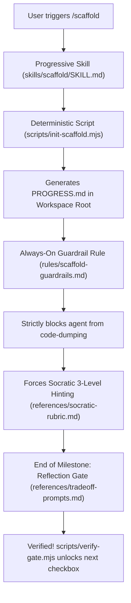

# 🏗️ Scaffold.ai — The Anti-Vibe-Coding Agent Skill

[](https://skills.sh)
[](https://opensource.org/licenses/MIT)
[](https://github.com/mo-farooq/Scaffold.ai)

> **Cure "AI Skill Atrophy".**  
> Scaffold is an open-source agent skill that transforms AI coding assistants from passive code generators into rigorous Socratic engineering mentors. It enforces progressive milestone pacing, blocks unsolicited solution dumps, and requires conceptual reflection gates before unlocking your next step.

---

## ⚡ Install in 5 Seconds

Works natively across **Google Antigravity**, **Claude Code**, **Cursor**, **Codex**, and **OpenCode**:

```bash
npx skills add mo-farooq/scaffold
```

*(Or inside Google Antigravity workspaces: copy `.agents/skills/scaffold` and `.agents/rules/` directly into your repo).*

---

## 🥊 The Problem: The "Vibe-Coding" Trap

Current AI coding agents default to writing complete implementations for you. While convenient, this creates **severe AI skill atrophy**:
* Developers commit thousands of lines of code they couldn't explain in a technical interview.
* Complex distributed systems fail in production because the engineer never learned the underlying trade-offs.
* "Vibe coding" gives you the illusion of productivity while eroding your architectural intuition.

### Scaffold vs. Standard Coding Agents

| Feature | Standard Coding Agents | Scaffold Socratic Skill |
| :--- | :--- | :--- |
| **Code Generation** | Dumps 300 lines of code directly into your files | **Strictly banned from writing your project code** |
| **Pacing** | Tries to finish the whole app in one prompt | Paces development into 3–5 bite-sized milestones |
| **Guidance** | Gives you the answer | Socratic hinting (Analogy → Flow → API pointer) |
| **Comprehension** | Assumes you understand | Blocks progress until you pass a **Reflection Gate** |
| **Progress Tracker** | None | Live split-pane **`PROGRESS.md`** with ASCII progress bar |

---

## 🖥️ The Split-Pane In-IDE Experience

Scaffold is designed to run natively inside your editor split:

```
┌──────────────────────────────────────┬──────────────────────────────────────┐
│  EDITOR LEFT: YOUR SOURCE CODE       │  EDITOR RIGHT: LIVE PROGRESS.MD      │
│                                      │                                      │
│  class RedisServer:                  │  # 🏗️ Scaffold Progress: Redis Clone │
│      def __init__(self, port=6379):  │                                      │
│          self.socket = socket.socket │  [████████░░░░░░░░░░░░] 40% (2/5)    │
│          ...                         │                                      │
│                                      │  - [x] Milestone 1: TCP Server ✅    │
│  # YOU write every line of code!     │  - [x] Milestone 2: RESP Parser ✅   │
│  # The agent guides architecture,    │  - [ ] Milestone 3: ▶ [ACTIVE] GET/SET│
│  # but NEVER writes your solution.   │  - [ ] Milestone 4: Key Expiration   │
│                                      │  - [ ] Milestone 5: Append-Only AOF  │
└──────────────────────────────────────┴──────────────────────────────────────┘
```

---

## 🚀 How to Use It

### 1. Start Any Custom Project Idea
In your agent's chat panel, type:
```text
/scaffold Build a rate-limited API in Node.js
```
Scaffold generates `PROGRESS.md`, locks the workspace guardrails, and introduces Milestone 1.

### 2. Or Pick a Curated "Build X from Scratch" Track
Want to master system design? Scaffold includes 5 battle-tested curriculum tracks:

```text
/scaffold track redis
```

| Track | What You Build | Core Concepts Mastered |
| :--- | :--- | :--- |
| [⚡ **Redis Clone**](tracks/redis-from-scratch.md) | In-memory key-value DB that connects with `redis-cli` | TCP sockets, RESP protocol, TTL sampling, AOF disk persistence |
| [🌳 **Git from Scratch**](tracks/git-from-scratch.md) | Content-addressable version control system | SHA hashes, zlib deflation, Merkle trees, commit DAGs |
| [🌐 **HTTP/1.1 Server**](tracks/http-server-from-scratch.md) | High-throughput web server from raw TCP sockets | RFC 7230 framing, packet fragmentation, persistent Keep-Alive |
| [🗄️ **Mini SQLite**](tracks/sqlite-from-scratch.md) | Embedded relational database with disk persistence | B+ Trees, 4KB page buffer cache, binary row serialization |
| [🐳 **Docker Runtime**](tracks/docker-from-scratch.md) | Process containerization runtime | Linux namespaces (`CLONE_NEWPID`), cgroups v2, OverlayFS |

---

## 🔒 The Dual-Layer Architecture

Antigravity and modern coding harnesses separate continuous constraints from on-demand workflows. Scaffold leverages both:



1. **Always-On Guardrail Rule (`rules/scaffold-guardrails.md`)**:
   Stays continuously active whenever `PROGRESS.md` exists. Blocks the agent from using file-editing tools to write your solution.
2. **Progressive-Disclosure Skill (`skills/scaffold/SKILL.md`)**:
   Runs the Socratic state machine under 5,000 tokens, loading pedagogical rubrics and trade-off prompts only when needed.
3. **Deterministic Helper Scripts (`skills/scaffold/scripts/`)**:
   Node.js scripts (`init-scaffold.mjs`, `verify-gate.mjs`) calculate mastery stats and update markdown checkboxes without consuming LLM context tokens.

---

## 🏆 Shareable Mastery Badges

When you complete all milestones in a project, Scaffold generates a verified completion badge for your project's `README.md`:

[](https://github.com/mo-farooq/Scaffold.ai)

```markdown
[](https://github.com/mo-farooq/Scaffold.ai)
```

---

## 📦 Legacy Standalone CLI Harness

The original Python standalone CLI / Textual terminal harness (`scaffold`) built during early prototypes is permanently preserved in the [`archive/cli-harness`](https://github.com/mo-farooq/Scaffold.ai/tree/archive/cli-harness) branch and release tag [`v0.1.0-harness`](https://github.com/mo-farooq/Scaffold.ai/releases/tag/v0.1.0-harness).

---

## 🤝 Contributing & Community

We welcome new system design tracks, trade-off questions, and language adapters!
1. Fork the repository
2. Add your curriculum blueprint under `tracks/your-system-from-scratch.md`
3. Submit a Pull Request

---

## 📄 License

MIT © [Mohammad Farooq](https://github.com/mo-farooq)
