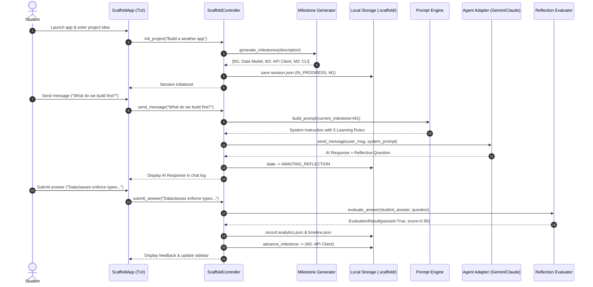

# Scaffold.ai — Repository Navigation & Codebase Orientation Guide

Welcome to the **Scaffold.ai** codebase! This guide provides a comprehensive map of the repository, explaining how the project is organized, what each directory and file does, how data and control flow through the system, and how to extend Scaffold.ai with new capabilities.

---

## 🗺️ Architectural Layer Map

Scaffold.ai is organized into **four decoupled layers**:

```
┌──────────────────────────────────────────────────────────────────┐
│                   1. PRESENTATION LAYER (UI)                     │
│  • src/scaffold/tui/ (Textual interactive terminal GUI app)       │
│  • Future: Web UI (FastAPI/React), VS Code Extension             │
└────────────────────────────────┬─────────────────────────────────┘
                                 │
┌────────────────────────────────▼─────────────────────────────────┐
│                 2. CONTROLLER ORCHESTRATION LAYER                │
│  • src/scaffold/controller.py (ScaffoldController)               │
│  (UI-agnostic coordinator between UI and underlying engines)     │
└───────┬────────────────────────┬────────────────────────┬────────┘
        │                        │                        │
┌───────▼──────────────┐ ┌───────▼──────────────┐ ┌───────▼────────┐
│  3. AGENT ADAPTERS   │ │   CORE AI ENGINES    │ │ 4. PERSISTENCE │
│  • adapters/base.py  │ │  • generator.py      │ │  & ANALYTICS   │
│  • adapters/gemini.py│ │  • prompt.py         │ │  • session.py  │
│  • adapters/claude.py│ │  • evaluator.py      │ │  • analytics.py│
│  • adapters/__init__.│ │  • validator.py      │ │  • timeline.py │
└──────────────────────┘ └──────────────────────┘ └────────────────┘
```

---

## 📂 Complete Directory Tree & Component Responsibilities

```
Scaffold/
├── .scaffold/                   # Local persistent storage (created at runtime)
│   ├── session.json             # Active project session state & milestone tracking
│   ├── analytics.json           # Reflection attempts, scores, and common misconceptions
│   └── timeline.json            # Concepts learned, files touched, and ADR references
│
├── docs/                        # Architecture & Engineering Documentation
│   ├── adr/                     # Architecture Decision Records (ADR-000 to ADR-007)
│   │   ├── ADR-000-template.md
│   │   ├── ADR-001-prompt-engine.md
│   │   ├── ADR-002-milestone-generator.md
│   │   ├── ADR-003-session-engine.md
│   │   ├── ADR-004-reflection-evaluator.md
│   │   ├── ADR-005-quality-gates-analytics.md
│   │   ├── ADR-006-agent-adapters.md
│   │   └── ADR-007-tui-controller-pattern.md
│   ├── definition_of_done.md    # Standard 9-point DoD checklist
│   ├── engineering_decision_log.md # Historical decisions log
│   ├── manual_testing_guide.md  # Comprehensive manual testing scenarios & recipes
│   ├── performance_budget.md    # Latency and throughput budgets
│   ├── repository_navigation.md # This orientation guide
│   └── user_testing.md          # User feedback and evaluation metrics
│
├── scripts/                     # Developer Tooling & Verification Automation
│   ├── benchmark.py             # Latency benchmarks (prompt build & session I/O)
│   ├── e2e_verify.py            # Headless full-stack simulated learning session
│   ├── test_lab.py              # Interactive developer manual testing playground
│   └── verify.sh                # Unified CI/CD quality gate (Ruff, Mypy, Benchmarks, Pytest)
│
├── src/scaffold/                # Production Source Code
│   ├── __init__.py              # Unified package API exports
│   ├── controller.py            # ScaffoldController: UI-agnostic orchestrator
│   ├── prompt.py                # Learning Mode prompt engine & 5 core protocol rules
│   ├── generator.py             # LLM dynamic project milestone generator
│   ├── session.py               # State machine & .scaffold/session.json persistence
│   ├── evaluator.py             # LLM student reflection answer grading & hints
│   ├── validator.py             # Programmatic protocol compliance checker (6 rules)
│   ├── analytics.py             # Reflection attempts & pass rate analytics engine
│   ├── timeline.py              # Conceptual learning timeline recorder
│   ├── adapters/                # Multi-Agent Connectors Layer
│   │   ├── __init__.py          # Factory registry: get_adapter(), list_available_adapters()
│   │   ├── base.py              # AgentAdapter abstract base class & AgentResponse model
│   │   ├── gemini.py            # Direct Gemini API adapter via google-genai SDK
│   │   └── claude.py            # Claude Code CLI subprocess adapter
│   └── tui/                     # Interactive Terminal UI Application (Textual)
│       ├── __init__.py          # TUI package entrypoint (main)
│       ├── __main__.py          # python -m scaffold.tui launcher
│       ├── app.py               # ScaffoldApp: Main Textual application shell
│       ├── scaffold.tcss        # Global terminal stylesheet
│       └── screens/             # Modular screen definitions
│           ├── __init__.py
│           ├── welcome.py       # Landing screen with New/Resume/Dashboard navigation
│           ├── setup.py         # Project idea input & async milestone generation
│           ├── session.py       # Main split-panel learning conversation & sidebar
│           └── status.py        # Progress dashboard, metrics & timeline table
│
├── tests/                       # Automated Test Suite (90+ tests)
│   ├── test_prompt.py           # 23 tests: prompt generation, rules, edge cases
│   ├── test_generator.py        # 11 tests: LLM milestone parsing, adaptive scaling
│   ├── test_session.py          # 11 tests: state machine transitions, serialization
│   ├── test_evaluator.py        # 9 tests: answer grading, score clamping, hints
│   ├── test_validator.py        # 3 tests: protocol validator rule diagnostics
│   ├── test_analytics.py        # 1 test: analytics persistence and pass rates
│   ├── test_timeline.py         # 1 test: learning timeline recording
│   ├── test_adapters.py         # 18 tests: adapter contracts, factories, mocks, live API
│   ├── test_controller.py       # 10 tests: UI-agnostic controller lifecycle & state
│   └── test_tui.py              # 4 tests: Textual pilot framework UI tests
│
├── preview_*.py                 # Single-purpose CLI inspector scripts
│   ├── preview_prompt.py        # Inspect generated system prompts
│   ├── preview_generator.py     # Inspect milestone generation for custom ideas
│   ├── preview_session.py       # Step through session transitions in terminal
│   ├── preview_evaluator.py     # Test answer evaluation with strong/weak answers
│   └── preview_adapters.py      # Send test prompts through Gemini or Claude adapters
│
├── pyproject.toml               # Package dependencies, scripts, and tool configs
└── README.md                    # Project overview & quick start
```

---

## 🔄 End-to-End Data & Control Flow

Here is what happens under the hood during a typical student learning journey:



---

## 🧑‍💻 How to Extend Scaffold.ai

### 1. Adding a New AI Agent Adapter (e.g. OpenAI or Ollama)
1. Create a new file in `src/scaffold/adapters/` (e.g. `openai.py`).
2. Subclass `AgentAdapter` from `src/scaffold/adapters/base.py`.
3. Implement:
   - `@property def adapter_name(self) -> str:` (e.g. return `"openai"`).
   - `def send_message(self, user_message: str, system_prompt: str = "") -> AgentResponse:`.
4. Register the new adapter class in `_ADAPTER_REGISTRY` in `src/scaffold/adapters/__init__.py`.
5. Add unit tests in `tests/test_adapters.py`.

### 2. Adding a New Learning Mode Protocol Rule
1. Open `src/scaffold/prompt.py`.
2. Append the new rule name and pedagogical instructions to `LEARNING_MODE_RULES`.
3. Update `src/scaffold/validator.py` to add a programmatic diagnostic check verifying agent compliance.
4. Update unit tests in `tests/test_prompt.py` and `tests/test_validator.py`.

### 3. Adding a New UI Frontend (e.g. Web UI or Desktop)
1. Do **not** re-implement business logic. Simply import `ScaffoldController`:
   ```python
   from scaffold.controller import ScaffoldController

   controller = ScaffoldController()
   session = controller.init_project("My project idea")
   response = controller.send_message("Let's begin")
   ```
2. Call `controller.send_message()`, `controller.submit_answer()`, and `controller.get_status()` to drive your web routes or desktop state.

---

## 🧪 Quick Navigation for Testing & Development

| Task | Primary Tool / Location |
|---|---|
| **Interactive Manual Testing** | `uv run python scripts/test_lab.py` |
| **Launch Terminal App** | `uv run scaffold` |
| **Run All Quality Gates** | `./scripts/verify.sh` |
| **Run Automated Unit Tests** | `uv run pytest -v` |
| **Run Performance Benchmarks** | `uv run python scripts/benchmark.py` |
| **Simulated E2E Verification** | `uv run python scripts/e2e_verify.py` |
| **Manual Testing Guide** | [`docs/manual_testing_guide.md`](file:///Users/Farooq/Scaffold/docs/manual_testing_guide.md) |
